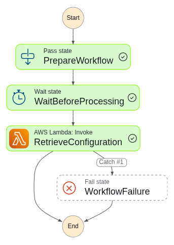
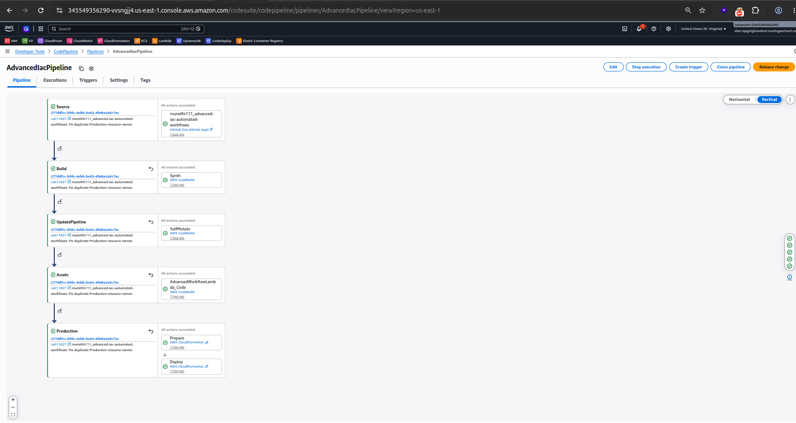

# Capstone Project: Advanced IaC & Automated Workflows

## 1. Project Overview

This project demonstrates how to use **AWS Cloud Development Kit (CDK)** and CI/CD automation to deploy and manage cloud infrastructure.

The application uses AWS Lambda to retrieve configuration data from AWS Systems Manager (SSM) Parameter Store. AWS Step Functions coordinates the workflow, while AWS CDK defines the infrastructure as code.

A CI/CD pipeline automates the building, testing, and deployment process.

## 2. AWS Services Used

- **AWS CDK:** Defines and deploys infrastructure using TypeScript.
- **AWS Lambda:** Runs the application logic.
- **AWS Systems Manager (SSM):** Stores application configuration.
- **AWS Step Functions:** Coordinates the automated workflow.
- **AWS CodePipeline:** Automates the CI/CD process.
- **AWS CodeBuild:** Builds and tests the application.
- **Amazon CloudWatch:** Stores Lambda logs and monitors execution.
- **AWS IAM:** Controls permissions between AWS services.

## 3. Project Architecture

The application follows this workflow:

1. A developer pushes code to GitHub.
2. AWS CodePipeline detects the changes.
3. The pipeline builds and tests the CDK application.
4. AWS CDK synthesizes and deploys the infrastructure.
5. Step Functions starts the automated workflow.
6. The workflow invokes AWS Lambda.
7. Lambda retrieves the configuration value from SSM Parameter Store.
8. CloudWatch stores the Lambda execution logs.

## 4. Project Structure

```text
advanced-iac-automated-workflows/
│
├── bin/
│   └── app.ts
│
├── lib/
│   ├── workflow-stack.ts
│   ├── pipeline-stack.ts
│   └── workflow-stage.ts
│
├── lambda/
│   └── index.js
│
├── statemachine/
│   └── workflow.asl.json
│
├── test/
│   └── workflow.test.ts
│
├── screenshots/
│   ├── 01-stepfunctions-success.png
│   ├── 03-codepipeline-success.png
│   └── 04-lambda-ssm-cloudwatch-logs.png
│
├── package.json
├── tsconfig.json
├── cdk.json
└── README.md
```

## 5. Deployed AWS Environment

The project was deployed in the AWS region:

**Region:** `us-east-1`

The deployed resources include:

| Resource | Name |
|---|---|
| Lambda function | `advanced-iac-workflow-lambda-prod` |
| SSM parameter | `/app/config/greeting-prod` |
| Step Functions state machine | `AdvancedWorkflowStateMachine` |
| CloudFormation stack | `Production-AdvancedWorkflowStack` |
| CI/CD pipeline | `AdvancedIacPipeline` |

The SSM parameter stores the following greeting:

```text
Hello from CI/CD Automated Infrastructure!
```

The Lambda function retrieves this value during workflow execution.

## 6. Installation and Setup

Clone the repository:

```bash
git clone <YOUR-GITHUB-REPOSITORY-URL>
```

Enter the project directory:

```bash
cd advanced-iac-automated-workflows
```

Install dependencies:

```bash
npm install
```

Install Lambda dependencies:

```bash
cd lambda
npm install
cd ..
```

## 7. Useful Commands

Build and type-check the project:

```bash
npm run build
```

Watch for changes and type-check:

```bash
npm run watch
```

Run unit tests:

```bash
npm run test
```

Synthesize the CloudFormation template:

```bash
npx cdk synth
```

Compare local infrastructure with the deployed environment:

```bash
npx cdk diff
```

Deploy the CDK stack:

```bash
npx cdk deploy
```

**Note:** Deploy the appropriate stack or pipeline stack when required by your CDK application. Check `cdk list` to see the available stacks.

## 8. Testing and Verification

The project was tested to verify that:

- The CDK application builds successfully.
- Unit tests pass.
- The Lambda function executes successfully.
- Lambda retrieves the greeting from SSM Parameter Store.
- Step Functions completes the workflow successfully.
- CodePipeline completes its build and deployment stages.
- CloudWatch records Lambda execution logs.

## 9. Screenshots

The `screenshots/` directory contains evidence of the deployed application.

The three required screenshots are:

---

1. **Step Functions:** Successful workflow execution showing the visual execution graph.



---

2. **CodePipeline:** Successful pipeline execution showing the build and deployment stages.



---


---


---

3. **CloudWatch Logs:** Lambda execution logs showing successful retrieval of the SSM Parameter Store value.


---

## 10. Conclusion

This project demonstrates Infrastructure as Code and automated workflows using AWS CDK.

It combines Lambda, SSM Parameter Store, Step Functions, CodePipeline, CodeBuild, IAM, and CloudWatch to create an automated and manageable deployment process.

The project also demonstrates how CI/CD can reduce manual deployment tasks and improve the reliability of cloud infrastructure.